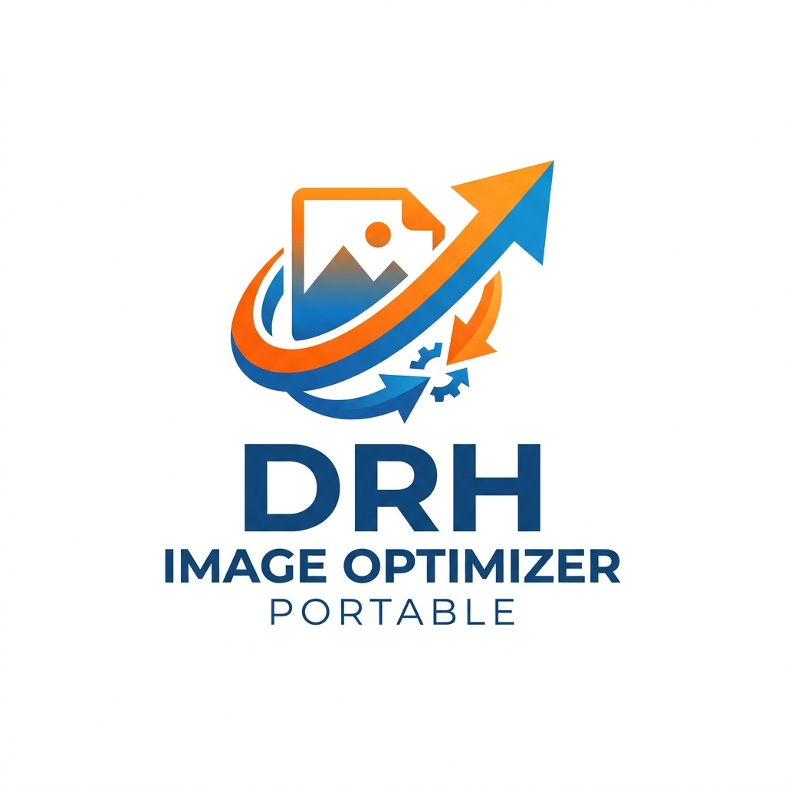

# DRH Image Optimizer Portable

**Drop a folder of screenshots. Get files small enough to send, without opening Photoshop.**

  

 

## The wall

Twelve PNG screenshots, 40 MB, and an email limit. Or a client folder where every JPEG carries GPS metadata and a camera name nobody wants to publish.

This runs the batch, tells you what it saved, and keeps a way back if the result is wrong.

## Three modes, three jobs

**Lossless** keeps decoded pixel content identical while optimizing compatible PNG and JPEG-family files. The safe default when the image is a deliverable.

**Smart** trades a measured amount of visual quality for practical size, which is what most web and document work actually needs.

**Ultra** pushes harder when the delivery size is the constraint and the image is a preview, a thumbnail, or a thumbnail's thumbnail.

## Around the modes

Drop-here batch workflows launch common modes straight from dedicated files, no window to configure. Metadata removal strips supported fields when a clean file matters. Safe replace commits the final output carefully and can restore the previous destination when recovery material exists. The GUI and CLI share the same engine, so an afternoon of clicking can become a scheduled job later.

Portable means it runs from a folder without an install, which helps on locked-down machines and on a USB stick you carry between them.

## Who it's for

People emailing screenshots all day. Web and docs work where page weight matters. Anyone cleaning metadata before a file leaves the machine.

## Get it

Windows build, portable. Current builds go to supporters directly rather than through a public download button. Process and delivery steps: [SUPPORT.md](SUPPORT.md)

Support the work: [Ko-fi](https://ko-fi.com/pacosalasv) · [PayPal](https://www.paypal.com/paypalme/pacosalas?locale.x=en_US&country.x=MX) (include the product name and your delivery email in the note)

Bugs and requests: [open an issue](https://github.com/pacosalasv/DRH_Image_Optimizer_Portable-Support/issues)

  

